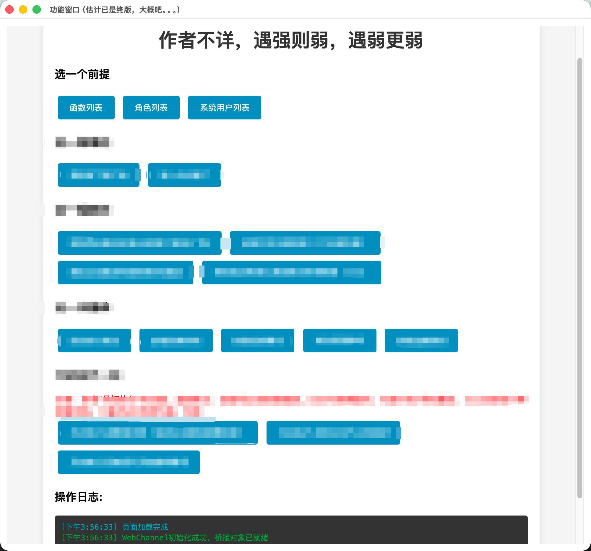

# 数据自动化桌面工具
因重复且频繁的表格数据需求，基于 PyQt 开发的桌面端业务数据治理工具。
频繁用于每日、每周、每月的数据汇总中，内部集成了账号管理、权限管理、各类业务功能
账号、权限管理确保了可供不同岗位人员使用不同功能

## 功能概览
- 账号、权限管理
- 数据更新与导入
- 多维度业务数据模块
- 月初执行模块

## 技术栈
- Python
- PyQt5
- PyMySQL
- SQLite3
- PyInstaller

## 项目结构
```text
src/
├── config/ # 配置（含加密配置）
├── entity/ # 数据实体
├── login/ # 登录模块
├── mapper/ # 数据访问层
├── service/ # 业务逻辑层
└── utils/ # 工具类
main.py # 入口
main.spec # 打包配置
build.sh # 构建脚本
```

## 已知不足
- **配置加密的局限**：数据库连接信息使用加盐加密存储，但运行时需读取本地盐值文件，
  盐文件本身未做进一步保护。但考虑到该项目为单人使用的内部工具，部署环境可控，故风险在可接受范围内
- **权限刷新非实时**：界面业务按钮已按账号权限控制显隐，但权限变更后需重启工具才会生效，
  未实现运行时热更新。考虑到权限调整频率低、工具为单人使用，故热更新并不是必要机制；
- **测试与异常处理有待完善**：核心逻辑当前依赖手动测试，缺少单元测试覆盖，且异常场景下的用户提示也较为简单
- **业务代码设计相对臃肿**：项目中对于相同的表格维护了两套单元格坐标体系，属于开发时过度设计

## 关于代码完整性

本项目基于实际企业业务场景开发。为保护原公司业务信息，
仓库保留了完整技术架构（分层结构、配置管理、数据访问层、工具类、界面实现），但业务逻辑层（service、mapper）实现代码未包含，
仅保留目录与职责说明。

本项目用于展示工程结构、技术选型与交付能力，非完整可运行版本。

注：截图中涉及具体业务的按钮文案已做打码处理。
